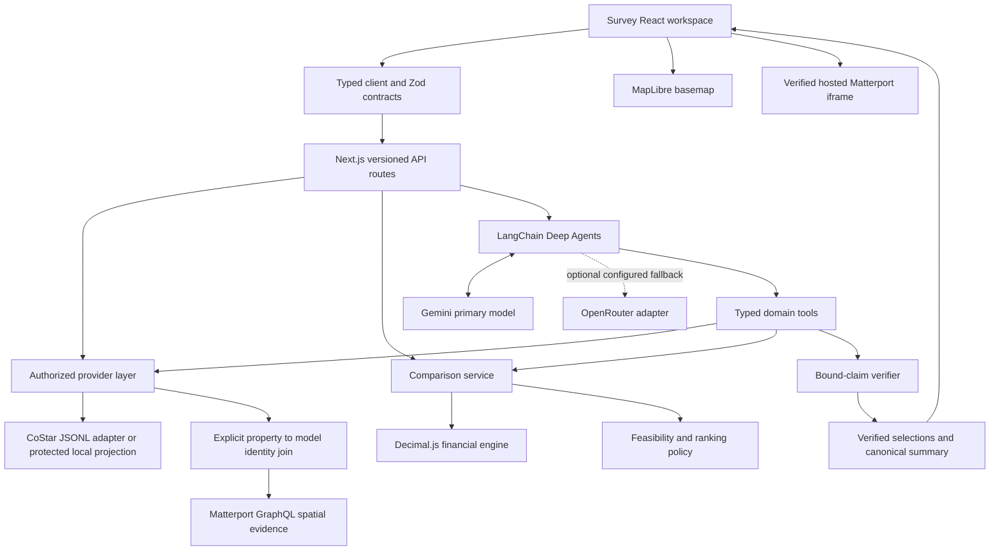

# KESTREL

### See what a building could become.

Kestrel is a commercial real estate investment workspace that connects property evidence, spatial exploration, explicit underwriting assumptions and verified agent analysis. It helps an investor compare a building's current-use baseline with two alternatives—and understand both the economics and the questions that remain unanswered.

Built for **HackPrinceton Fall 2026**, Kestrel combines CoStar property records, Matterport room estimates and hosted tours, deterministic financial calculations, and Google Gemini running through LangChain Deep Agents. Its **Survey** interface moves from building evidence to an investor-facing research memo in five connected stages:

**Overview → Building → Underwriting → Comparison → Investigation**

The current authorized localhost demonstration supports **five genuine commercial properties and three accessible embedded Matterport tours**. This public repository distributes the application source and synthetic test fixtures, not the licensed sponsor dataset, protected property mappings or credentials.

[Product walkthrough](#product-walkthrough) · [Architecture](#architecture) · [Agent execution](#how-an-investigation-executes) · [Financial methodology](#financial-methodology) · [Run and test](#getting-started) · [Limits](#limitations-and-next-steps)

## Why Kestrel exists

Commercial real estate decisions span disconnected systems: property records describe the asset, a digital twin reveals parts of its physical layout, spreadsheets encode assumptions, and research notes explain the proposed investment. Each transition creates opportunities to lose provenance, confuse an assumption with a fact, or carry a result from one property into another.

Kestrel brings those steps into one workspace for investors, acquisition teams and analysts conducting preliminary reuse screening. The central question is concrete: **which modeled alternative offers the strongest incremental annual operating income within the supplied investment and return constraints?**

A higher modeled income is not proof of legal permission, structural suitability or superior investment return. Kestrel keeps those distinctions visible alongside the recommendation.

## Product walkthrough

### 1. Overview: establish the asset

Select a property from the authorized portfolio and inspect its source-backed details. Prominent metrics appear only when available; missing information remains visible in the supporting detail and evidence sections rather than becoming a zero or a fabricated market estimate.

Property information carries provenance. The workflow distinguishes supplied records, live spatial retrieval and hypothetical user assumptions. Switching properties clears the previous property's drafts and results, cancels pending requests and prevents late responses from appearing under the new selection. This is an in-memory workspace, not a saved portfolio system.

### 2. Building: explore the place behind the numbers

The Building stage pairs a MapLibre map with an existing hosted Matterport player. Where a verified model and accessible hosted tour are available, users can navigate the real scan, explore Dollhouse mode and inspect the building interactively. No custom 3D engine or Bundle SDK is required.

Room measurements come from the Matterport GraphQL integration and are displayed with their units and coverage limitations. They are estimates, not surveyed dimensions. Missing width, depth, height or floor area stays unknown; partial room coverage does not establish the building's total rentable area.

The current curated catalog includes four verified property-to-scan bindings, of which three have accessible hosted tours. A matched scan can provide measurements without an accessible hosted tour. A property without a verified scan remains usable for financial scenarios while clearly reporting unavailable spatial evidence.

### 3. Underwriting: make assumptions explicit

Each property has three editable scenarios: a baseline and two mutually exclusive alternatives. **Quick Analysis** and **Advanced Underwriting** edit the same underlying draft. Switching modes preserves values rather than creating competing models.

Advanced groups cover lease economics, occupancy and collections, operating expenses, capital/conversion costs, soft costs and contingency, and additional assumptions. Capital and return constraints accompany the scenario set. Validation distinguishes missing financial inputs from unavailable external evidence.

**Load illustrative investment example** is an explicit user action, with replacement confirmation for edited drafts. The preset uses the selected property's recorded rentable area; rents, occupancy, expenses, costs and cost basis are clearly disclosed hypothetical assumptions. It does not invent area, submit a comparison or initiate an AI call. All values remain editable.

### 4. Comparison: inspect the pro forma

The Comparison stage presents the server-calculated income waterfall and investment metrics side by side: potential income, vacancy and collection losses, concessions, operating expenses, NOI, incremental NOI, initial investment, simple payback and yield on cost where supported.

Eligibility and ranking come from a deterministic policy. The preferred option can change when the budget changes, without requiring a model call. The prepared primary-property example demonstrates a conditional preference at a $2 million budget that switches when only the budget is reduced to $1 million; that outcome belongs to those disclosed assumptions, not to every property in the catalog.

Editing inputs marks an existing comparison out of date. Recalculation records the new input revision and can show whether the preference changed. Repeated common screening warnings are grouped for readability while scenario-specific explanations retain their attribution.

### 5. Investigation: read the investment memo

Analyze, Compare, Risks, Explain and Summary request the same bounded agent workflow with different action guidance. They are five entry points and presentation emphases, not five unrelated agents or a guarantee of different conclusions.

The default presentation leads with the recommendation, financial highlights, investment rationale, important risks, unresolved questions and grouped evidence. Source-composition labels describe where the data came from; verification labels describe checks performed on the analysis. Neither is a confidence score.

An expandable **Technical Audit** retains tool names and call identifiers, execution receipts, exact values, assumptions, evidence references and verification counters. It exposes execution evidence, not hidden chain-of-thought. Editing underwriting inputs makes the previous memo stale and hides its recommendation and verification receipt until a new analysis is completed.

No sponsor-data screenshots are included here: permission to display a temporary judging demonstration is not treated as permission to redistribute its contents in a public repository.

## Architecture

Kestrel uses one Next.js application with a strict browser/server boundary. Shared Zod contracts validate inputs and responses. Provider adapters, credentials, financial calculations and agent execution stay on the server. React components format results and manage interaction state.



Map tiles and the hosted tour are browser resources. They do not supply the financial engine's canonical inputs or establish the property/model identity join.

### API surface

- `GET /api/v1/properties`: authorized catalog.
- `GET /api/v1/properties/[id]`: selected property details.
- `GET /api/v1/properties/[id]/spatial`: matched spatial context and permitted tour information.
- `POST /api/v1/scenarios/compare`: validated scenarios and constraints to deterministic results.
- `POST /api/v1/analysis`: bounded agent investigation using those scenarios and constraints.

Requests and responses carry property identity and input revisions. The browser rejects incompatible responses instead of accepting an old result for a different selection. Mutation endpoints validate request origins, including the legitimate configured loopback origin; localhost is not a reason to remove origin checks.

## How an investigation executes

### 1. Validate and authorize

The browser submits the selected property ID, input revision, scenarios, constraints and requested action. The server validates the contract, obtains authorized property/spatial context and checks data-display and model-processing permissions.

Insufficient inputs can return `needs_input` before any model call. Authentication, licensing and property-identity failures are not instructions to ask the model to work around the restriction.

### 2. Run the native Deep Agents workflow

Gemini is the primary model, configured by default as `gemini-3.1-flash-lite`. Deep Agents supplies the planning/orchestration runtime. The workflow requires actual completed tool results, not merely a model saying that it consulted a source.

The execution uses the native `write_todos` planning tool and four domain tools:

- **`getPropertyContext`** retrieves context for the selected authorized property and its matched spatial evidence.
- **`proposeScenarios`** validates the submitted scenario selection. Despite its internal name, it does not invent a new investment program or silently replace the user's assumptions.
- **`runComparison`** executes the existing deterministic comparison service for the submitted property and revision.
- **`verifyAnalysis`** accepts a bounded structured selection of financial claims, property facts, room dimensions, risks and the proposed preferred scenario, then checks it against held evidence and completed results.

The model chooses tool calls and structured analytical focus. The application owns the data, permissions, arithmetic and ranking policy. A matching successful tool result is required before an invocation can count as completed.

### 3. Verify bound claims

The independent verifier checks that referenced evidence belongs to the authorized execution, quantitative financial selections agree with canonical comparison results, and the selected recommendation matches the supplied constraints and ranking policy. Spatial claims must belong to the verified property/model pairing. An unavailable measurement cannot become a known dimension.

This is deliberately narrower than verifying arbitrary natural-language prose. The model submits typed claims; the published explanation is assembled from checked selections and canonical templates. Unverified closing model prose is not promoted into the final memo.

### 4. Allow one bounded correction

Correctable output failures can receive sanitized structured validation feedback and one corrective submission within the same native agent run. The corrected submission is independently checked again. The model cannot alter source data, constraints, tool permissions or deterministic results to make a claim pass.

The run shares limits of **eight physical model attempts, sixteen tool calls and sixty seconds**, with a per-model timeout and output-token cap. Retry/fallback attempts and correction share those limits; correction does not start a second custom orchestration loop.

Authentication, licensing and identity failures are terminal. If correction fails or execution becomes unavailable, the direct deterministic comparison remains usable independently.

### 5. Return a receipt, then render the memo

A successful complete response includes the comparison, evidence, summary, model usage and actual execution metadata. Successful verified responses can carry:

```text
execution.verification.status             verified
execution.verification.method             bound_claims_v1
execution.verification.submissionAttempts  1 or 2
execution.verification.correctionAttempts  0 or 1
```

These counters count structured verifier submissions, not model calls. A verified receipt establishes consistency with available evidence and the screening policy, not independent confirmation of zoning, market truth or investment return.

The frontend's pure memo adapter groups evidence, formats numeric strings and organizes the same response into an investor-facing hierarchy. Tool evidence references indicate records associated with execution; they are not proof that the model individually examined every record. The returned evidence list and tool-associated evidence counts need not be equal.

### Provider resilience

The existing model middleware bounds transient retries and supports an optional configured OpenRouter fallback. Non-retryable errors do not trigger indiscriminate provider switching. The fallback adapter is implemented, but live OpenRouter failover was **not verified for this release**. The authorized demonstration uses Gemini; optional secondary processing requires its own configuration and applicable permission.

## Financial methodology

Canonical arithmetic lives in [the financial engine](lib/finance/calculate.ts), using Decimal.js with 28-digit precision and half-up rounding. API amounts are decimal strings; UI rounding does not change calculations. The model never calculates the authoritative financial results.

The engine models stabilized, annual, unlevered USD operating economics over a common calendar-year period. Rent must use a supported gross or modified-gross basis with an explicit normalization note. Unsupported or undisclosed lease bases do not silently become comparable gross rents.

Let `A` be rentable square feet, `R` annual rent per rentable square foot, `O` occupancy ratio and `L` collection-loss ratio:

```text
Potential rent          = A × R
Potential gross income  = potential rent + potential other annual income
Vacancy loss            = potential rent × (1 − O)
Occupied scheduled rent = potential rent × O
Collection loss         = occupied scheduled rent × L
Effective gross income  = occupied scheduled rent − collection loss
                          − concessions + effective other annual income
Other income loss       = potential other income − effective other income
NOI                     = effective gross income − owner operating expenses
```

Potential and effective other income are separate inputs. Missing values remain missing; explicitly modeling no other income is an assumption of zero, not an inference from absent data. Expenses use either a disclosed total or a complete supported itemization, avoiding double-counting.

```text
Initial investment = renovation + conversion + soft costs + contingency + other capital
Incremental NOI    = alternative NOI − baseline NOI
Simple payback     = initial investment ÷ incremental NOI
Yield on cost      = annual NOI ÷ disclosed total project cost
```

Payback requires a positive incremental NOI and known investment; it is not applicable to the baseline. Non-positive incremental income does not earn a misleading finite payback. Yield on cost requires a positive, disclosed total cost basis that includes the initial investment. **Total project cost is not a substitute for missing capex**, and yield on cost is not incremental NOI divided by renovation cost.

Each result retains its formula identifier, relevant fields, units and an unavailable reason where necessary.

### A fully synthetic example

The following numbers are test-fixture assumptions, not sponsor facts or a valuation of any catalog property. Assume 10,000 rentable square feet, normalized gross rents, no other income, no collection loss and no concessions:

- **Baseline:** $20/sq ft/year at 90% occupancy, $60,000 operating expenses → $180,000 effective gross income and **$120,000 NOI**.
- **Alternative A:** $30/sq ft/year at 90% occupancy, $80,000 expenses and $300,000 investment → **$190,000 NOI**, $70,000 incremental NOI and approximately **4.29 years** simple payback.
- **Alternative B:** $35/sq ft/year at 80% occupancy, $85,000 expenses and $450,000 investment → **$195,000 NOI**, $75,000 incremental NOI and **6 years** simple payback.

These are exercised in the [financial regression tests](tests/finance/calculate.test.ts). A separate disclosed $2 million total cost basis for Alternative A produces a 9.5% yield on cost; a missing cost basis produces an unavailable value, not an inferred denominator.

### Eligibility before ranking

The [feasibility policy](lib/feasibility/compare.ts) evaluates legal, physical and financial conditions separately. Unknown legal feasibility remains unverified. Risk tolerance can permit conditional screening; it does not convert uncertainty into approval.

At least one capital or return constraint is needed before selecting a preference. Among qualifying alternatives with positive incremental NOI, ranking maximizes incremental annual NOI, then favors lower initial investment, with stable ID ordering as the final tie-break. Depending on available evidence and constraints, the result can be a conditional preference, provisional retention of the baseline, or insufficient evidence.

This is income screening, not discounted cash flow, debt underwriting, formal valuation or a certified highest-and-best-use determination.

## Evidence, identity and privacy

**Identity precedes spatial evidence.** The server joins commercial property IDs to the supplied model index explicitly and rejects ambiguous or conflicting bindings. Address similarity alone does not authorize a scan. Tour access and publication are checked separately from identity; a listed model is not assumed to have an accessible hosted player.

**Provenance is not confidence.** A licensed cached property record and live spatial retrieval can produce a mixed source composition. That label says nothing by itself about whether the selected claims passed verification. User assumptions remain labeled assumptions even when the calculation using them is correct.

**Unknown is a valid result.** The application does not substitute a room-area sum for rentable area, an illustrative rent for a market quote, or another property's tour for a missing scan.

**Public code does not imply public data rights.** Sponsor records, normalized projections, property/model mappings, credentials, raw responses, private runtime configuration and real-data recordings are not part of this distribution. Server adapters are isolated from client imports, and restricted inputs must stay out of browser static assets and build artifacts. Only the intended authorized display fields cross the API boundary; raw source datasets are not served.

The local demonstration uses established owner-authorized configuration. Its event permissions do not grant blanket redistribution or indefinite retention rights to someone cloning this repository.

## Technology stack

| Technology | Actual role | Why it matters |
| --- | --- | --- |
| Next.js 16 / React 19 / TypeScript | App Router UI and server routes | One typed application with explicit server boundaries |
| Zod 4 | Shared request/response schemas | Rejects malformed inputs and incompatible responses |
| Decimal.js | Canonical financial arithmetic | Avoids binary floating-point financial calculations |
| LangChain Deep Agents | Native planning and typed tool orchestration | Connects model decisions to completed domain operations |
| Google Gemini | Primary tool-calling model | Selects structured analytical focus within bounded execution |
| OpenRouter integration | Optional secondary model adapter | Configurable fallback; live failover remains unverified |
| Matterport GraphQL / hosted Showcase | Room estimates and native interactive tour | Spatial evidence without a replacement 3D engine |
| MapLibre GL JS / Turf | Geographic context and geometry helpers | Property map with honest fallback states |
| Tailwind CSS / Radix / shadcn/ui / Lucide | Accessible controls and Survey styling | Shared interaction and visual primitives |
| Recharts | Charting support | Presentation of existing numeric results |
| Vitest / Playwright | Offline domain tests and browser regression | Separates deterministic correctness from UI interaction |

Archivo and Newsreader are bundled locally with their [SIL Open Font License notice](app/fonts/LICENSE.txt). The interface does not need a runtime Google Fonts request.

## Repository map

```text
app/                       Pages, layout, styles, fonts and API routes
  api/v1/                  Property, spatial, comparison and analysis endpoints
components/                Shared product controls and UI primitives
features/
  dashboard/               Survey shell, navigation and request state
  property/                Property evidence and room presentation
  map/                     Map and spatial exploration
  scenarios/               Shared drafts, Quick/Advanced editors and pro forma
  analysis/                Actions, research memo adapter and Technical Audit
lib/
  contracts/               Shared DTO exports and typed browser client
  schemas/                 Zod schemas
  providers/               Server-only property and spatial adapters
  finance/                 Decimal financial engine
  feasibility/             Eligibility and ranking policy
  agent/                   Deep Agents execution, model middleware and verifier
  reporting/               Canonical and verified summaries
  scenarios/               Explicit illustrative-example preparation
scripts/                   Authorized local demo launcher
tests/                    Synthetic fixtures and unit/integration/live suites
e2e/                       Mocked browser workflow specifications
```

## Getting started

### Public source development

Use **Node.js 24** and npm with the committed lockfile:

```bash
git clone https://github.com/Aleks-Nikitin/kestrel.git
cd kestrel
npm ci
# Create a local template only if there is no existing environment file.
test -e .env || cp .env.example .env
npm run dev
```

A fresh clone does **not** include sponsor data, authorization or a working licensed catalog. A restricted catalog response is expected until the operator has legitimate access and the approved runtime configuration. Do not bypass the agreement gate to make an empty checkout appear functional. Public development and regression tests use synthetic fixtures; there is no automatic synthetic substitution in real-data mode.

The relevant environment-variable names include:

- `GOOGLE_API_KEY`: server-only Gemini credential.
- `GEMINI_MODEL`: optional primary model selection.
- `MATTERPORT_API_KEY`, `MATTERPORT_API_TOKEN`: server-only GraphQL credentials.
- `OPENROUTER_API_KEY`: optional secondary-provider credential, not sufficient by itself to enable fallback or authorize sponsor processing.
- `NEXT_PUBLIC_MAP_STYLE_URL`: public basemap style URL, never a server secret.
- `APP_ORIGIN`: configured browser origin for mutation checks.

Access, display and third-party-processing permissions are separate requirements. The safe template leaves sponsor access disabled. Environment files are local; do not commit populated copies or expose server keys under a `NEXT_PUBLIC_` name.

### Authorized local demonstration

For an operator who already has the reviewed protected configuration and appropriate permissions:

```bash
npm run demo        # Production build, then authorized local launch
npm run demo:start  # Start an already-built application
```

The approved demo runs at **http://localhost:3000** and stays on localhost. Internet access remains necessary for live sponsor/model services, the hosted tour and basemap. Generic `npm start` does not provision the authorized demo configuration and is not interchangeable with the launcher.

Do not overwrite an existing environment file, fabricate permission flags or distribute private configuration to make the public repository reproducible. Unsaved drafts are lost on reload or property changes; prepare the presentation tab before recording.

### Tests and builds

```bash
npm run typecheck
npm run lint
npm run test:unit
npm run test:integration
npm run build
```

For mocked browser regression in a dedicated checkout with port 3000 available:

```bash
npx playwright install chromium
npm run test:e2e
```

The Playwright configuration builds and starts its own server on port 3000 and does not reuse an existing server. **Do not run it against a presenter's occupied demo port.** Builds also replace the checkout's generated output; use an isolated checkout while a production demonstration is running.

`npm run test:live` is separate: it requires protected local prerequisites and can contact real sponsor APIs and paid model services. Run it only with explicit authorization and an appropriate budget. Missing live prerequisites fail rather than silently proving a mocked substitute.

## Verification record

The release was checked on the Mac with Node 24.11.1. After the focused Comparison deduplication fix, **311 unit tests across 32 files and 72 integration tests across 9 files passed**, together with typecheck and lint.

The focused fix also passed an isolated production build and **51 mocked Chromium tests**. Those browser results establish fixture-backed interaction behavior, not live sponsor integration.

Separately, authorized real-browser checks covered the five-property catalog, three hosted tours, property switching, shared Quick/Advanced values, deterministic budget-sensitive comparison and mobile interaction. A genuine Gemini investigation on the integrated Survey candidate returned a complete analysis with a verified receipt, one submission and zero corrections. Editing an input hid the stale memo and receipt. No model call is needed to repeat offline finance or verifier tests.

Offline regression covers unsupported spatial dimensions, wrong financial claims, budget violations, mismatched evidence, a valid corrective submission, a rejected correction and execution limits. A successful live correction and live secondary-provider failover are not claimed. Some verbatim inference text retains longer decimal precision; prominent financial highlights use readable formatting.

## Engineering decisions and tradeoffs

- **Keep finance outside the model.** Tool calling supplies deterministic results; typed claim selection and independent verification constrain what becomes a published memo.
- **Use explicit identity joins.** Fewer verified scans are preferable to confidently attaching the wrong building's evidence.
- **Separate access from presentation.** A functioning localhost UI still needs real sponsor authorization; a polished mock cannot establish it.
- **Share drafts across underwriting modes.** Quick mode simplifies entry without creating a second calculation engine or losing Advanced inputs.
- **Prefer the native hosted tour.** Matterport handles exploration; Kestrel concentrates on matching, spatial context and investment workflow.
- **Bound repair inside existing orchestration.** One corrected submission improves resilience without adding a new agent platform, persistence layer or repair graph.
- **Keep the memo readable and the audit inspectable.** Default presentation suppresses repeated technical clutter while preserving underlying receipts and meaningful limitations.

## HackPrinceton context

Kestrel was built for HackPrinceton Fall 2026 with these intended judging targets: **Best Business & Enterprise Hack**, **CoStar — Inside and Out**, **LangChain — Best Use of Deep Agents**, **Amazon — Best Practical AI Innovation**, and **MLH — Best Use of Gemini API**. These are submission goals, not claims of awards or confirmed category enrollment.

The demonstrable contributions are a connected commercial decision workflow, verified property/spatial integration, real native agent tool execution, deterministic financial comparisons and a budget change that can alter eligibility and preference. No AWS integration or extra provider is implied by the Amazon judging target.

## Limitations and next steps

The current product is a curated, five-property localhost demonstration, not a general searchable commercial listing service. Scan coverage and hosted publication are limited. Room estimates, modeled occupancy and hypothetical rents do not establish renovation feasibility or market demand.

Financial analysis excludes debt service, depreciation, transaction costs, downtime and lease-up timing. It does not implement DCF, IRR, NPV or tax modeling. Legal and physical checks preserve uncertainty rather than issuing professional approvals. Model availability and hosted-resource loading depend on external services.

There is no database-backed saved workspace, multi-user authorization system or production hosting configuration in the judged workflow. Explicit budget edits support adaptive re-evaluation; free-form instructions do not silently rewrite investment constraints.

Possible future work includes rights-aware dataset import, comparable-market evidence, saved workspaces and richer financial modeling. ZIP import and those extensions are **not implemented features** of this release.

## Credits and publication

Thanks to the HackPrinceton organizers for the event and sponsor access. CoStar Group and Matterport supplied hackathon property/spatial resources under their applicable terms. Google Gemini, LangChain Deep Agents and the listed open-source libraries provide model and application infrastructure; Kestrel's integration, financial policy, verification and workspace are project implementation.

The default basemap uses [OpenFreeMap](https://openfreemap.org/quick_start/). Retain the displayed OpenFreeMap, OpenMapTiles and OpenStreetMap attribution and review the [upstream licenses](https://github.com/hyperknot/openfreemap/blob/main/LICENSE.md) before changing or redistributing map assets. Map tiles provide context, not sponsor matching evidence. An explicitly empty style setting selects the labeled plain-background fallback used by repeatable browser tests.

Archivo is credited to the Archivo Project Authors and Newsreader to the Newsreader Project Authors, with local subsets packaged by Fontsource. Their bundled license is separate from application-source licensing. No project-wide source license is currently supplied; public GitHub visibility alone does not grant an open-source reuse license, and sponsor content is not relicensed by this repository.

**Kestrel supports preliminary investment analysis. It is not an appraisal, zoning determination, structural inspection or investment guarantee.**
